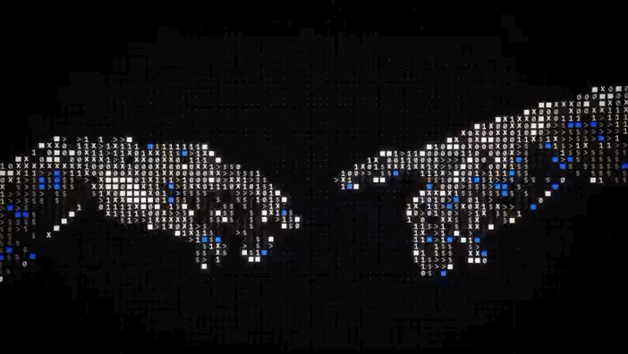

  

<h1 align="center">Hi 👋🏻, I'm Benjamín</h1>

<h3 align="center">Full Stack Developer</h3>

  

<h2 align="center">🚀 About Me</h2>

So here's the coffee ☕ I'm a full stack developer passionate about building web applications and bringing ideas into production, one commit at a time.

I blend structured code, robust database architectures, and intuitive user experiences into real, actual, shipped products. I work end-to-end: from designing scalable architectures and REST APIs to crafting modern, reactive user interfaces.

My days basically go: dream up a concept → build it → break it → fix the bug I definitely just created → repeat until it works → act surprised when it works.

Aggressively hands on, mildly caffeinated, permanently turning wild ideas into reality powered by curiosity, coffee, and clean commits.

 

<h2 align="center">🤝 Connect</h2>

<h2 align="center">💻 Tech Stack</h2>

  

<h2 align="center">📊 GitHub Stats</h2>

  

  
  

<h2 align="center">📈 Activity Graph</h2>

  

<h2 align="center">⌘ Commit Activity</h2>

  

<h2 align="center">⌘ Philosophy</h2>

  <em>"El buen código siempre parece que fue escrito por alguien a quien realmente le importaba."</em>
   
  — Robert C. Martin

  

